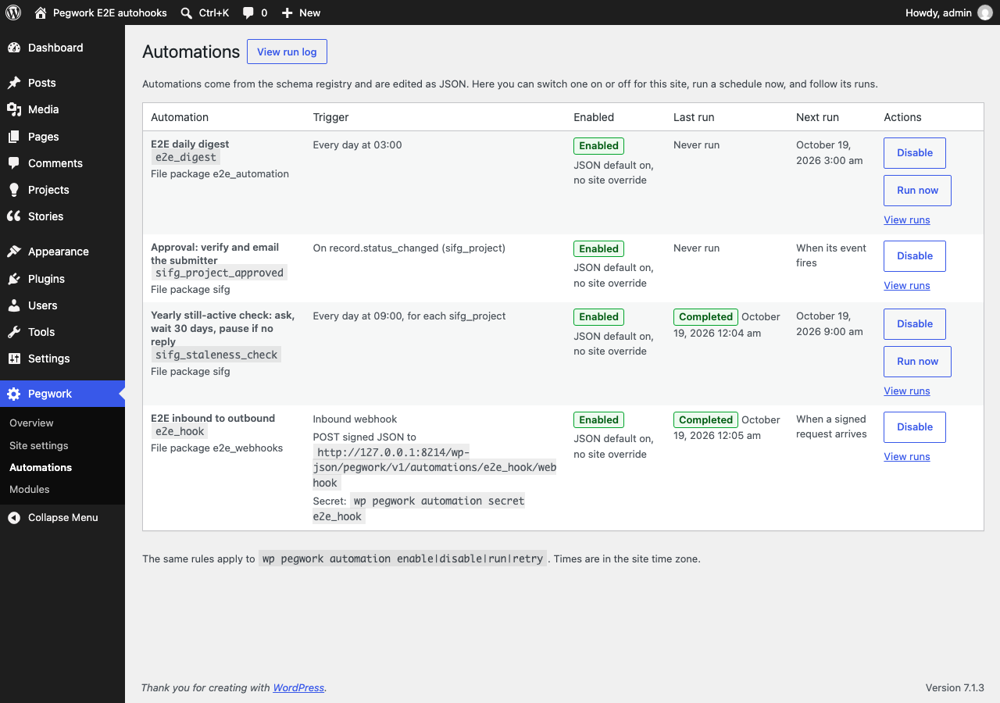
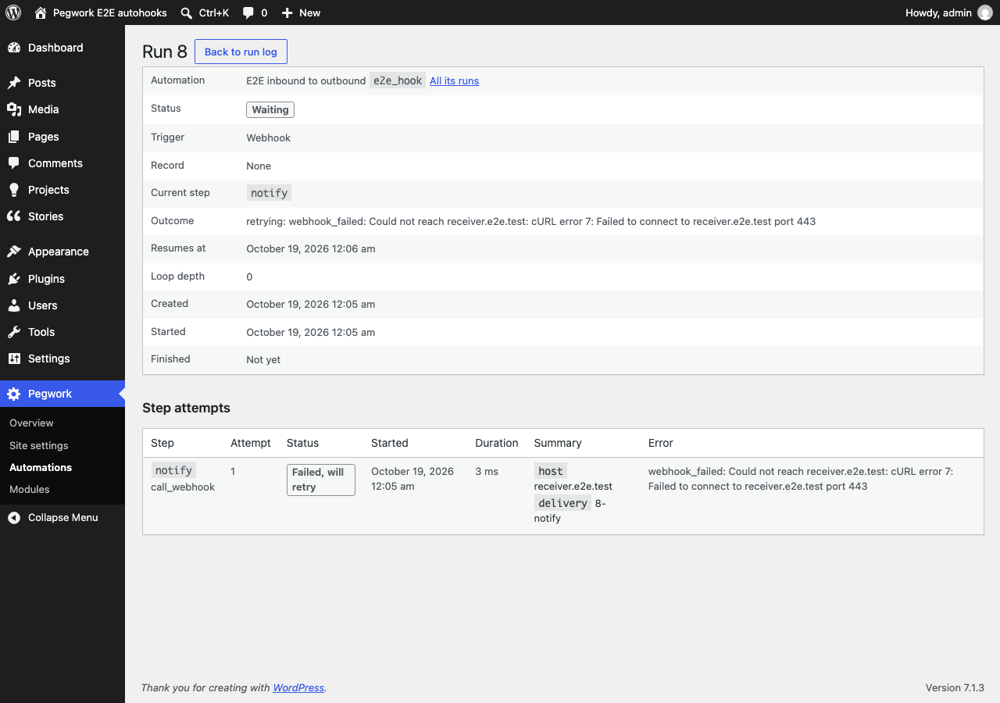
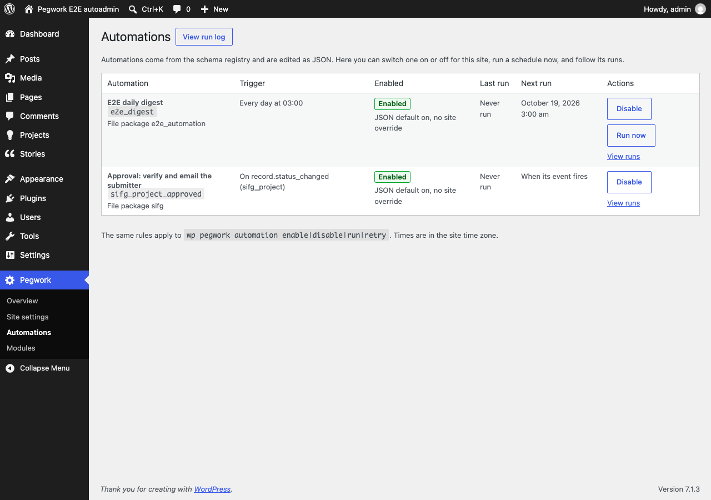
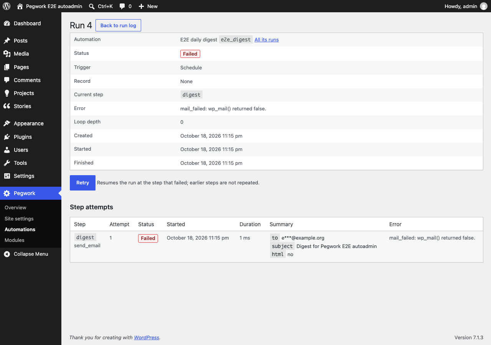

# Automation module

Module `automation` (`modules/automation/`, namespace `PegworkAutomation\`): runs the registry's automations (`docs/registry-reference.md#automations`) in the background, logs every run, and adds `wp pegwork automation` and Pegwork > Automations. Design: `docs/phase-4-design.md` sections 6 and 8 and its 2026-10-18 decisions. Uses only `Pegwork\Api` (Records, Module, `ADMIN_MENU`), `pegwork_registry()` and WordPress.

Status (Phase 4 PRs 5 to 7): event, schedule (`for_each` sweeps) and webhook triggers; steps `update_record`, `create_record`, `condition`, `send_email`, `call_webhook`, `wait`; retries; signed links (`{{link.*}}`, the public link handler, link runs); the inbound webhook endpoint and per-automation secrets; WP-Cron wake-ups; maintenance; CLI `list`, `log`, `run`, `tick`, `retry`, `enable`, `disable` (`--now`, `--sync`), `link`, `link-key`, `secret`; admin screens (list, toggles, Run now, run log and detail, Retry). A run that reaches a step type without a handler (a definition newer than the module) fails with `unsupported_step` (earlier steps keep their effect; no retry).

Enable: `wp pegwork module enable automation` (or Pegwork > Modules). Disabled, nothing is included: no listener, no tables touched, no runs.

## How a run happens

1. A record event fires (`docs/events.md`). For each automation with an `event` trigger on that name (narrowed by `content_type` or `form`) and effectively enabled, the listener evaluates `when` against the record and payload, synchronously (old values exist only now).
2. Loop cap: if the payload's `origin.depth` is 3 or more (filter `pegwork_automation_max_depth`), it inserts a `skipped` run with error `loop_depth: ...` and runs no steps.
3. Idempotency: with `idempotency`, the rendered key must be new for that automation (unique index on `automation, idempotency_key`; keys over 191 bytes are stored as `md5:<hash>`). A repeat creates nothing.
4. It inserts a `queued` run (trigger payload in `context`, capped at 16 KB) and schedules `pegwork_automation_run` [run id] for now. The saving request never runs steps.
5. On wake-up the executor claims the run atomically (`UPDATE ... SET status = 'running' WHERE id = %d AND (status = 'queued' OR (status = 'waiting' AND resume_at <= now))`, proceeding only on 1 row), so a duplicate WP-Cron firing or a re-entrant call does nothing. A removed automation cancels the run (`automation_removed`), a disabled one too (`automation_disabled`), a `current_step` missing from the definition fails it (`definition_changed`).
6. Steps run in order from `current_step`, the record re-read through `Records::get()`. Each attempt writes one `pegwork_run_steps` row. Writes go through `Pegwork\Api\Records` with origin `{ automation, run_id, depth: run depth + 1 }`, so they are validated and emit events that may start further runs.
7. Time budget: before each step after the first in a wake-up, if 20 s have passed (filter `pegwork_automation_time_budget`), the run goes back to `queued` at that step and is re-scheduled. At most 100 step attempts per run (`step_limit`).
8. Waits and retries (one mechanism): the run becomes `waiting` with `resume_at` (UTC) and `current_step` (the step after a `wait`; the same step for a retry), and a wake-up is scheduled for `resume_at`. The claim only takes a waiting run once `resume_at` has passed, so an early or duplicate wake-up does nothing; the daily maintenance (or `tick`) re-schedules a waiting run whose wake-up was lost. A trailing `wait` completes the run at once.
9. End: `completed` (a false `condition` stores outcome `stopped_at:<id>` in `context.outcome`), or `failed` with the step's error (`<code>: <message>`, for example `pegwork_invalid_record: ...`; after retries ` (after N attempts)` is appended).

Effective enabled state: option `pegwork_automation_overrides` (`key => on|off`, set by `enable`/`disable`) wins over the JSON `enabled`.

## Schedule triggers

`{ "type": "schedule", "every": "hour|day|week", "at": "HH:MM", "for_each": { ... } }` (`docs/registry-reference.md#triggers`).

- One WP-Cron event `pegwork_automation_schedule` [key] per effectively enabled schedule automation, created on boot when missing (or pulled in when the pending one is later than the definition now gives). Times are site time and keep the wall clock across DST: `day` at `at` (default `00:00`), `hour` at the minute of `at` past each hour, `week` at `at` on the first day of the week (Settings > General, `start_of_week`). A firing reschedules itself first; a disabled or removed automation is not rescheduled (boot re-creates it once enabled).
- Without `for_each`: one run with no record per firing (`trigger_type` `schedule`, `trigger` empty). Its `idempotency` renders without a record (for example `digest:{{today}}`).
- With `for_each`: a sweep over posts of `content_type` with `status` (default `publish`) in ID order, 50 IDs per query. Each record is read through `Records::get()`, `where` is evaluated against it, and a match creates one run bound to it unless the idempotency key exists. Sweeps need an idempotency key such as `{{record.id}}:{{record.last_verified}}`: it changes only when the data changes, so a daily sweep emails once per cycle, and pruning old runs cannot cause a re-send while the data is unchanged. Without one, every firing re-runs every match.
- `max_runs` (default 200) caps the runs one sweep creates. The next match after the cap stops the sweep and is logged as a `skipped` run with error `max_runs: ...`; the rest are picked up next firing (records that already have a run are duplicates by key).
- Time budget (`pegwork_automation_time_budget`, 20 s): a sweep that uses it up continues in a chained event `pegwork_automation_sweep` [key, last ID, runs created so far].

## Steps: email, wait, retries

`send_email`: `to`, `subject`, `text` (required), `html`, `reply_to`; all templates.
- From the site's default sender via `wp_mail()`. `to` renders to 1 to 5 addresses separated by commas or semicolons (`too_many_recipients`); each part is an address (a literal or a field such as `{{record.contact_email}}`) or `{option:<page>.<field>}`, read with `pegwork_get_option()` (options pages, core). Option tags are taken from the template, never from rendered values, so record data cannot name one. Every address must pass `is_email()` (`invalid_recipient`); an empty list is `no_recipient`; a site without `pegwork_get_option()` gives `options_unavailable`. Duplicates are dropped case-insensitively.
- `subject` and `text` render as text: taxonomy keys show term names, lists join with ", ", and the HTML entities WordPress stores in titles and the site name are decoded (as core's own emails do). Line breaks are removed from the subject. Without `html` the mail is `text/plain; charset=UTF-8`.
- With `html`: sent as `text/html` with `text` as the plain-text alternative (PHPMailer `AltBody`, set by a `phpmailer_init` callback added and removed around this one call). Every merge-tag value is escaped: `esc_url` for `record.permalink`, `record.edit_url`, `site.url`, `link.*` and `url` fields, `esc_html` for everything else (no double encoding, so a stored `&amp;` renders "&"). The authored template is trusted (committed config, imported by CLI only).
- Privacy: private fields may appear in the email (it goes to the record's own contact by design) and nowhere else. The step summary holds `to` masked (`o***@example.org`), the subject rendered with private fields as `[private]`, and `html` (bool); never the body. Error messages have recipient addresses masked.
- `wp_mail()` returning false is retryable; the `wp_mail_failed` message becomes the error (`mail_failed: ...`). Recipient errors and a body that renders empty (`empty_body`; PHPMailer refuses it) are not retried.

`wait`: `for` (ISO 8601, `PT1H` to `P2Y`). Calendar units move in site time (`P30D` keeps 09:00 across a DST change). Summary `for`, `resume_at`.

Retries: a failed attempt is retried when the failure is retryable and the step's policy has retries left: the run-step row is `retrying`, the run waits at the same step (`error` `retrying: <error>` meanwhile), and the attempt number counts up per step. Policy: the step's `retry` (`max`, `backoff`: one duration for every retry, or a list with the last entry repeating; `backoff` omitted means the type's default, else `PT15M`), else the type default: `send_email` 2 retries `PT15M` apart, `call_webhook` 3 after `PT1M`, `PT10M`, `PT1H` (4 attempts in all), others none. Configuration failures (`unsupported_step`, recipient errors, bad durations) are never retried. `wp pegwork automation retry <run>` resumes a failed run from its failed step with the policy counted afresh.

## Scheduler and clock

- `Scheduler` (`src/Scheduler/Scheduler.php`): `schedule( $hook, $args, $timestamp ): bool` (replaces a pending firing with the same hook and args), `unschedule( $hook, $args )`, `next( $hook, $args ): ?int`. It is only the wake-up transport; `pegwork_runs` is the source of truth.
- `WpCronScheduler` (default): WP-Cron single events. When it schedules something due now, the request calls `spawn_cron()` at shutdown (filter `pegwork_automation_spawn_cron`, skipped inside cron and with `DISABLE_WP_CRON`), so a run does not wait for the next visitor. On low-traffic sites prefer a system cron: `DISABLE_WP_CRON` plus `wp cron event run --due-now` every minute.
- Action Scheduler is not bundled (decision 8 in the design): an AS 4.2+ adapter implementing the same three methods is a dependency bump once the WordPress minimum is 6.9.
- `InlineScheduler` (CLI `--sync` and `--now`): holds `pegwork_automation_run` and `pegwork_automation_sweep` wake-ups in memory and fires the due ones in process, in time order, including the follow-ups they schedule; other hooks pass to the site scheduler, and what is still pending at the end (a wait or retry not yet due) is handed to it, replacing any pending firing for the same run.
- `Clock` (`now(): DateTimeImmutable`, UTC): `SystemClock`, `FrozenClock` (`set()`, `advance( 'P12M' )` in site-time calendar units). Business time (`today`, `now`, date operands, stored timestamps, maintenance time, schedule times, waits, backoff) comes only from the clock; the time budget uses wall time. `PegworkAutomation\Engine::use( $clock, $scheduler )` swaps both (tests, `--now`, `--sync`).

## Maintenance

Daily `pegwork_automation_maintenance` at 03:00 site time (self-rescheduling; boot re-creates it if missing):
- re-schedules `queued` runs idle for 10 minutes and `waiting` runs past `resume_at` that have no pending wake-up (lost WP-Cron events, or events that fired while the module was disabled); `tick` runs only this part, replacing pending wake-ups;
- marks `running` runs whose last claim is over 15 minutes old as `failed` (`interrupted: ...`), never repeating a side effect automatically;
- prunes `completed`, `skipped` and `cancelled` runs after 90 days and `failed` after 180 (option `pegwork_automation_retention_days` `{ done, failed }`, filter of the same name), with their steps. `queued`, `running` and `waiting` runs are never pruned.

## Tables

Installed and upgraded with `dbDelta` on boot when option `pegwork_automation_db_version` differs from `Schema::VERSION` (1). Dropped by `modules/automation/uninstall.php` (run by Pegwork's `uninstall.php`), which also clears both cron hooks.

`{prefix}pegwork_runs`

| Column | Type | Notes |
|---|---|---|
| `id` | bigint unsigned PK | |
| `automation` | varchar(64) | key |
| `trigger_type` | varchar(16) | `event`, `schedule`, `manual` (`run --record` on an event automation), `link` (a signed link click; runs the link's steps), `webhook` (a verified inbound request) |
| `record_id` | bigint unsigned null | bound record |
| `status` | varchar(16) | `queued`, `running`, `waiting`, `completed`, `failed`, `cancelled`, `skipped` |
| `current_step` | varchar(64) | step running or next to run |
| `resume_at` | datetime null | UTC; when a `waiting` run (wait or retry) may resume |
| `depth` | tinyint unsigned | trigger `origin.depth` |
| `idempotency_key` | varchar(191) null | |
| `definition_hash` | char(32) | md5 of the canonical definition at trigger time |
| `context` | longtext | JSON: `event`, `trigger` (payload), `steps` (outputs), `outcome`, `retries` (step ID => automatic retries made), `link` (link runs: the link whose steps run) |
| `error` | text null | reason or `<code>: <message>` |
| `created_at`, `claimed_at`, `started_at`, `finished_at` | datetime | UTC; `claimed_at` is the last claim (stuck detection, orphan idle time) |

Indexes: `(status, resume_at)`, `(automation, created_at)`, `(record_id)`, unique `(automation, idempotency_key)`.

`{prefix}pegwork_run_steps`: `id` PK, `run_id`, `step_id` varchar(64), `step_type` varchar(32), `attempt` smallint (per step, counting retries), `status` (`ok`, `failed`, `retrying`), `started_at`, `duration_ms`, `summary` (JSON: `record_id`, `keys`, `content_type`, `status`, `passed`, `for`, `resume_at`, email `to` masked and `subject` with private fields hidden; never field values of private fields), `error`. Index `(run_id)`.

Privacy: `context.trigger` may hold private values (`old.*`); it is never printed. The CLI shows statuses, summaries and errors only.

## Steps

`Step` interface (`src/Steps/Step.php`): `run( array $step, Context $context, array $run ): StepResult`. `StepResult::ok( $output, $summary )`, `::stop( $summary )` (ends the run as completed), `::wait( $resume_at, $summary )` (the run waits, then continues with the next step), `::fail( $code, $message, $summary, $retryable = true )` (retried per policy when retryable). Handlers are registered in `Engine::__construct()` by type; the executor decides retries (`Retry::delay()`).

| Type | Does | Output |
|---|---|---|
| `update_record` | `Records::update( record or bound, values )`; refreshes the bound record | `record_id` |
| `create_record` | `Records::create( content_type, values, status )` | `record_id` |
| `condition` | continues when `when` holds, else stops (`stopped_at:<id>`) | none |
| `send_email` | `wp_mail()`, see above | none |
| `call_webhook` | signed `wp_safe_remote_post()`, see Webhooks | `status` |
| `wait` | waits `for` | none |

`values`: a non-string literal is passed as is; a string that is exactly one merge tag passes the raw value (`{{record.tags}}` stays a list, `{{record.urgent}}` a boolean); other strings are rendered. Taxonomy keys accept a list or a comma-separated string of slugs; a list written to a field (no field type holds one) becomes comma-separated text, so `"paused_from": "{{record.sifg_project_status}}"` stores `active`. The Records API sanitizes, validates and rejects (status changes are not possible through it). In a link run, `update_record` may only write the link's own record: a `record` template naming another fails with `link_scope` (no retry).

Conditions (`Conditions::evaluate`): lists compare as sets (`eq` with a scalar means exactly that one slug; `in`/`not_in` any overlap; `contains` list membership); empty is null, '' or []; order operators are false on empty values; numbers compare numerically, booleans as booleans, `Y-m-d` and ISO datetimes as instants in site time, else strings.

Templates (`Templates::render( $template, $context, $mode )`): `raw` (values, idempotency keys: lists as comma-separated slugs, booleans `1`/`0`), `text` and `html` (email, above), `log` (private fields as `[private]`, signed links as `[link]`, never minted). `Context::is_private()`, `field_type()` and `taxonomy()` answer for `record.<key>` and `trigger.old.<key>` paths. `{{link.<name>}}` mints a signed URL for the run's record (see below); `Context` takes the automation key as its sixth argument for this, and without a record or key it renders empty.

## Signed links

An automation's `links.<name>` (`docs/registry-reference.md#signed-links`) is a one-click action on one record. `{{link.<name>}}` in an email renders `home_url( '/?pegwork_link=<token>' )`; opening it runs only that link's steps (`update_record`, `condition`), only on that record, as a run with `trigger_type` `link`. The owner needs no account.

Token (`src/Links/Token.php`): `v1.<base64url(json {a: automation, l: link, r: record ID, e: expiry})>.<base64url(HMAC-SHA256(key, "v1." + payload))>`. Stateless: verification needs no table. The signature is checked with `hash_equals()` before the payload is read; at most 512 bytes are read. Expiry is minted as the link's `expires` after the render time (engine clock), so every email carries a link valid for the full lifetime from its own send (`P365D` in SI for Good: the "still active?" link and the pause notice's fresh link both reactivate). One token per link per run render, so an email's text and HTML parts carry the same link.

Key (`src/Links/Key.php`): constant `PEGWORK_LINK_SECRET` (wp-config.php) when defined and non-empty, else option `pegwork_link_secret` (32 random bytes, base64, autoload off), generated the first time a link is minted (verification never creates one). Not `wp_salt()`, whose rotation would silently kill every outstanding link. Never printed, logged or exported (export covers the registry only). `wp pegwork automation link-key` says which source is in use (and warns when the constant is shorter than 32 characters); `--rotate` replaces the option, invalidating every link sent so far (refused while the constant is set).

Handler (`src/Links/Handler.php`, `template_redirect` priority 0, module enabled only):
- URL: a query variable on the home URL, not a pretty path such as `/pegwork-link/<token>/`: no rewrite rule to add and flush when the module is switched on or off, and it works on every permalink setting, plain included. The confirm form POSTs `pegwork_link` and `_wpnonce` to `home_url( '/' )`, so the token is not in the POST's URL.
- `GET` with `confirm: true` (default): a confirm page with one button. Mail scanners that prefetch links therefore cannot act. `GET` with `confirm: false` acts at once; `HEAD` never acts; other methods get 405.
- The confirm POST carries a WordPress nonce for action `pegwork_link_<sha256 of the token>`. Nonces work for visitors who are not logged in (user 0) and last 12 to 24 hours; a missing or stale one shows the confirm page again (403) with a notice, and nothing changes.
- Acting: the run is inserted with idempotency key `link:<sha256 of the token>` and executed in the request (`Engine::links()->run()`, then the executor). The steps' writes go through the Records API (validated, events with origin depth 1). Then a 303 redirect to `success_url` (a site path under the home URL, or an absolute URL that `wp_validate_redirect()` allows), else a thank-you page with `success_message` (default "Your response has been recorded.").
- Each token acts once: a second click finds its run and shows "Already done" (or "Something went wrong" when that run failed; `wp pegwork automation retry <run>` resumes it). The stored key is a hash, so the token cannot be rebuilt from the log.
- Refusals, all changing nothing and starting no run: not valid (malformed, tampered, other key: 403; nothing in the token is trusted); expired (410, or 303 to the link's `expired_url`); unavailable (404: automation, link or record gone, automation disabled, record in the trash or of another type); too many requests (429 with `Retry-After`).
- Rate limit: 30 requests per address per 10 minutes (transient `pegwork_link_rate_<md5>`, counted before the token is read; filter `pegwork_automation_link_rate_limit`, 0 turns it off). The address is `REMOTE_ADDR` only: forwarded headers are not trusted, so behind a proxy every visitor may share one address; raise the limit there.
- Pages (`src/Links/Page.php`): standalone HTML (site name, heading, message, the record title when its field is public, one button or a home link), no scripts or external resources, works with JavaScript off, `lang` and `dir` from the site, AA contrast and a visible focus ring. Page texts (`button`, `success_message`, URLs) render in `log` mode, so private fields (already rejected at load time) and links never appear. Headers: `nocache_headers()` (`no-store`), `X-Robots-Tag: noindex, nofollow`, `Referrer-Policy: no-referrer` (the token does not leak to a redirect target), `X-Frame-Options: DENY`, `Content-Security-Policy: default-src 'none'; style-src 'unsafe-inline'; form-action 'self'; frame-ancestors 'none'; base-uri 'none'`, and `DONOTCACHEPAGE` for page cache plugins.

Executor step-list source: `Executor::step_list( $definition, $run )` gives a `link` run the steps of `links[ context.link ]` and every other run the automation's `steps`. A link removed from the definition fails a waiting or queued link run with `definition_changed`.

## Webhooks

Design: `docs/phase-4-design.md` sections 7, 9 and 10. Code: `src/Steps/CallWebhook.php`, `src/Webhooks/` (`Secrets`, `Signature`, `Inbound`).

Secrets (`Secrets`): one per automation that has a webhook trigger or a `call_webhook` step, used for both directions. Option `pegwork_automation_secrets` (`key => 64 hex characters`, 32 random bytes, autoload off), generated on first use (first delivery, first inbound request for that automation, or `wp pegwork automation secret <key>`). Never in the registry JSON, schema exports (they cover the registry only), the run log, error messages or admin screens; removed on uninstall with the other `pegwork_` options. `wp pegwork automation secret <key>` prints it (the only place it is printed); `--rotate` replaces it after a confirmation (`--yes` skips it) and prints the new one: signatures made with the old one stop verifying, in both directions.

Signature (`Signature`), the same both ways: `X-Pegwork-Timestamp: <Unix seconds>`, `X-Pegwork-Signature: sha256=<hex HMAC-SHA256 of "<timestamp>.<raw body>" keyed with the secret>`, compared with `hash_equals()`; timestamps more than 300 s from now either way are refused (replay window).

Outbound (`call_webhook`: `url` template, `fields`, `timeout` at most 15 s, default 10): a step of a background run, so the save that triggered it never waits for or depends on the receiver.
- `wp_safe_remote_post()` (no private or loopback addresses, ports 80, 443 and 8080 only), `redirection` 0 (a 3xx is a failed attempt), `Content-Type: application/json; charset=utf-8`, User-Agent `Pegwork/<version>; <home URL>`.
- Body: `{ "event", "automation", "run_id", "delivered_at" (UTC ISO 8601 of this attempt), "record": { "id", "type", "status", "permalink", "fields": {...} } }`. `event` is the event name, or the trigger type (`schedule`, `webhook`, `manual`) for other runs. `record` is null when the run has no record. `fields` holds the step's `fields` keys, or every public field and taxonomy (slug lists) of the type when it has none. Private fields are never sent: the registry rejects them in `fields` (`automation_private_field`) and the step skips them too. The `url` template is a public context (private fields rejected at load time).
- Headers: `X-Pegwork-Delivery: <run id>-<step id>`, stable across retries (receivers dedupe on it), plus a fresh timestamp and signature per attempt.
- A 2xx answer succeeds (output `status`). Any other status or a transport error fails the attempt with `webhook_failed: <host> answered HTTP <n>.` or `webhook_failed: Could not reach <host>: <transport message>`, retryable: 3 retries after `PT1M`, `PT10M`, `PT1H` (step `retry` overrides), then the run fails with ` (after 4 attempts)` and shows in the run log. A URL that does not render to `http(s)://` fails with `invalid_url`, not retried.
- Run log summary: `host`, `delivery`, `status` (when there was an answer); the step row has the duration. Never the secret, the signature, the URL path or a body.

Inbound: `POST /wp-json/pegwork/v1/automations/<key>/webhook` (also `/?rest_route=/pegwork/v1/automations/<key>/webhook`) starts a run of an enabled automation with `{ "type": "webhook" }`.
- Checked in `rest_pre_dispatch`, before WordPress decodes the body: 30 requests per minute per automation (fixed windows on the engine clock, transient `pegwork_automation_hook_<md5 of key>`, every request counted, filter `pegwork_automation_webhook_rate`): 429 with `Retry-After`; keys that are not enabled webhook automations share one bucket. Then a body (or `Content-Length`) over 64 KB: 413. Then a media type other than `application/json` (parameters such as `charset` allowed): 415.
- Permission callback: signature and replay window as above. A bad, missing or stale signature and an unknown, disabled or non-webhook automation all get the same 401 (`pegwork_webhook_unauthorized`); unknown keys are checked against a throwaway key, so no secret is created for them.
- Callback: a body that is not a JSON object or array is 400 (invalid JSON gets WordPress's own `rest_invalid_json` 400); a decoded payload over 15 KB (it is stored in the run context, at most 16 KB) is 413. `X-Pegwork-Delivery` (1 to 128 of `A-Z a-z 0-9 . _ : -`, else 400) becomes the idempotency key `delivery:<id>`, taking the place of the automation's `idempotency` template; without it the template applies, if any. Answers `202 { "run_id", "status": "queued" }`, or `200 { "run_id" (the first run), "duplicate": true }` for a repeated delivery. The payload is never echoed.
- The run: `trigger_type` `webhook`, no record, depth 0, `trigger.payload.*` in templates and conditions (the only trigger paths the registry allows). Payload values reach records only through `create_record`/`update_record`, so the Records API sanitizes and validates them; a value a field rejects fails the run (`pegwork_invalid_record`) and writes nothing.
- The Automations list shows the inbound URL of each webhook automation and the `secret` command, never the secret.

### Verifying Pegwork webhooks

A receiver of `call_webhook` deliveries (and a sender to the inbound endpoint) uses the automation's secret from `wp pegwork automation secret <key>`. Sign and verify the raw body bytes exactly as sent; re-encoding parsed JSON changes them.

PHP:

```php
$body      = file_get_contents( 'php://input' );
$timestamp = $_SERVER['HTTP_X_PEGWORK_TIMESTAMP'] ?? '';
$signature = $_SERVER['HTTP_X_PEGWORK_SIGNATURE'] ?? '';
$expected  = 'sha256=' . hash_hmac( 'sha256', $timestamp . '.' . $body, PEGWORK_WEBHOOK_SECRET );

if ( ! ctype_digit( $timestamp ) || abs( time() - (int) $timestamp ) > 300 || ! hash_equals( $expected, $signature ) ) {
	http_response_code( 401 );
	exit;
}
$delivery = $_SERVER['HTTP_X_PEGWORK_DELIVERY'] ?? ''; // Seen before? Answer 2xx and do nothing.
$event    = json_decode( $body, true );
```

n8n, as pseudocode for a Code node ("Run Once for Each Item") after a Webhook node with the "Raw Body" option on, so the exact bytes arrive as binary data; `crypto` must be allowed (`NODE_FUNCTION_ALLOW_BUILTIN=crypto`) and the secret kept in an n8n variable or credential, not in the workflow:

```js
const crypto = require( 'crypto' );
const secret = $env.PEGWORK_WEBHOOK_SECRET;
const headers = $input.item.json.headers;
const raw = Buffer.from( $input.item.binary.data.data, 'base64' ).toString( 'utf8' );
const timestamp = headers[ 'x-pegwork-timestamp' ];
const expected = 'sha256=' + crypto.createHmac( 'sha256', secret ).update( `${ timestamp }.${ raw }` ).digest( 'hex' );
const given = headers[ 'x-pegwork-signature' ] || '';
const fresh = Math.abs( Date.now() / 1000 - Number( timestamp ) ) <= 300;
if ( ! fresh || given.length !== expected.length || ! crypto.timingSafeEqual( Buffer.from( given ), Buffer.from( expected ) ) ) {
	throw new Error( 'Bad Pegwork signature' ); // Respond 401 from an error branch.
}
return { json: { delivery: headers[ 'x-pegwork-delivery' ], event: JSON.parse( raw ) } };
```

Sending to the inbound endpoint (n8n HTTP Request node or any client): serialize the body once, then sign that string:

```text
body      = JSON string of the payload, for example {"title":"From n8n"}
timestamp = current Unix time in seconds
headers   = Content-Type: application/json
            X-Pegwork-Timestamp: <timestamp>
            X-Pegwork-Signature: sha256=<hex HMAC-SHA256(secret, timestamp + "." + body)>
            X-Pegwork-Delivery: <your unique ID, optional; repeats are ignored>
POST body to https://<site>/wp-json/pegwork/v1/automations/<key>/webhook
expect 202 {"run_id": n, "status": "queued"} (or 200 with "duplicate": true)
```





## WP-CLI

```
wp pegwork automation list [--format=<format>]
wp pegwork automation log [<key>] [--run=<id>] [--status=<status>] [--limit=<n>] [--format=<format>]
wp pegwork automation run <key> [--record=<id>] [--now=<datetime|offset>] [--sync]
wp pegwork automation tick [--now=<datetime|offset>] [--sync]
wp pegwork automation retry <run> [--now=<datetime|offset>] [--sync]
wp pegwork automation enable <key>
wp pegwork automation disable <key>
wp pegwork automation link-key [--rotate] [--yes]
wp pegwork automation link <automation> <link> <record> [--now=<datetime|offset>]
wp pegwork automation secret <key> [--rotate] [--yes]
```

- `secret`: prints the automation's webhook secret, generating it on first use (only for automations with a webhook trigger or a `call_webhook` step); `--rotate` replaces it after a confirmation and prints the new one. Printed with `WP_CLI::line()` only when asked; nothing else prints or logs it.

- `link-key`: where the link key comes from (constant, option, or not generated yet), never the key; `--rotate` replaces the option after a confirmation (`--yes` skips it).
- `link`: prints a signed URL for a link on a record, exactly as an email would carry it, and its expiry; for testing (anyone with the URL can use it). The record must be of the automation's bound type. `--now` mints as of another time (refused in production), for example `--now=-400days` for an expired link.

`list`: key, label, trigger, JSON `enabled`, site override, effective state, last run (status, UTC time), open runs (queued, running, waiting), failures in the last 7 days, next schedule firing (site time). `log --run=<id>`: the run, then each step attempt (status, duration, summary, error). `disable` stops new runs; queued runs are cancelled when they wake. CLI access implies admin; the admin screens check `manage_options` and nonces (below).

- `run`: a schedule automation fires once now (sweeping its records, or only `--record`, filters still applied) without moving its regular schedule; an event automation starts one run against `--record` (`trigger_type` `manual`, payload `id`, `type`, `status`, origin source `cli`; `when` is not evaluated, the idempotency key applies). Disabled automations are refused.
- `tick`: resumes waiting runs whose `resume_at` has passed and queued runs idle for 10 minutes, replacing pending wake-ups. It never prunes or interrupts runs.
- `retry <run>`: failed runs only; resumes at the failed step (earlier steps are not repeated), retry policy counted afresh.
- `--sync`: executes the runs and everything they trigger in this process (`InlineScheduler`); later wake-ups go to WP-Cron. Without it, runs are queued for WP-Cron.
- `--now`: sets the clock for this process only and implies `--sync`: a site-time datetime (`"2027-11-02 09:00"`) or an offset from now (`+12months`, `"+13 months"`, `+P30D`, `-PT1H`). Refused when `wp_get_environment_type()` is `production` (WordPress's default when `WP_ENVIRONMENT_TYPE` is unset), so set `WP_ENVIRONMENT_TYPE` to `local`, `development` or `staging` on test sites. Waits created under `--now` are stored on that timeline (`resume_at` in the future of the real clock), so resume them with a later `tick --now`; `tick --now` also runs queued runs that look idle on the moved clock, with that clock.

## Local runbook: one SI for Good staleness cycle

On a test site with the `sifg` package (siforgood.local with `sifg-config`, or `bin/e2e-local-site.sh start <name> <port>`, which registers `examples/sifg`), `WP_ENVIRONMENT_TYPE` set to `local` (`wp config set WP_ENVIRONMENT_TYPE local`) and a way to read mail (Local's Mailpit; on an E2E site the forms mu-plugin logs mail to option `pegwork_e2e_mail`). Time travel is per process: `--now` moves the clock for one command, and the link is clicked on the real clock afterwards.

1. Enable and check the key: `wp pegwork module enable automation`, `wp pegwork automation link-key` (no key until the first link is minted).
2. Submit and approve a Project:
   ```sh
   ID=$(wp post create --post_type=sifg_project --post_status=pending --post_title="Runbook Garden" \
     --post_content="$(printf 'Neighbours share tools, seeds and time to grow food together. %.0s' 1 2 3 4 5 6)" \
     --meta_input='{"_sifg_project_contact_email":"owner@example.org","_sifg_project_needs_volunteers":"1","_sifg_project_volunteer_link":"https://example.org/volunteer"}' \
     --user=admin --porcelain)
   wp post term set $ID sifg_project_type nonprofit --user=admin
   wp post term set $ID sifg_project_status active --user=admin
   wp post update $ID --post_status=publish --user=admin
   wp cron event run --due-now            # or let WP-Cron run it
   wp pegwork automation log sifg_project_approved --limit=1
   ```
   Expect a `completed` run, Last verified today (`wp post meta get $ID _sifg_project_last_verified`), and the email "Runbook Garden is live on ..." with the permalink and "Last verified: <today>".
3. Twelve months later: `wp pegwork automation run sifg_staleness_check --now=+12months`. Expect `Matched 1, created 1 run(s)`, the run `waiting` at `still_stale`, and the email "Is Runbook Garden still active?" with a `?pegwork_link=v1...` line. Running it again (`--now="+12 months +1 day"`) creates nothing: the idempotency key `{{record.id}}:{{record.last_verified}}` already has a run.
4. No reply: `wp pegwork automation tick --now=+14months` (14, not 13: twelve months plus 30 days can pass 13 months, for example from late January). Expect `Resumed 1 run(s)` and the run `completed` at `tell`; Status `paused` (`wp post term list $ID sifg_project_status --field=slug`); private `_sifg_project_paused_on`, `_paused_from` (`active`) and `_paused_volunteers` (`1`) set, Needs volunteers off; the email "Runbook Garden is paused on ..." with a fresh link; the public REST view (`/?rest_route=/wp/v2/projects/<ID>`) shows the paused term and no contact email or paused fields.
5. Reactivate: open the link from the first email in a browser (JavaScript on or off). Expect "Please confirm" with the Project's name and the button "Yes, it is still active"; press it; expect "Thank you. Your listing stays live on ...". Then Status `active`, Needs volunteers back on, the paused fields empty, Last verified today (real clock). `wp pegwork automation log sifg_staleness_check` shows a `link` run `completed` at `restore`; `log --run=<id>` lists `verify`, `was_paused` (`passed: true`), `restore`. Opening the link again says "Already done".
6. Refusals: change a character of the link (expect "This link does not work", 403); mint an expired one with `wp pegwork automation link sifg_staleness_check still_active $ID --now=-400days` and open it (expect "This link has expired", 410). Neither changes the record.

To repeat the cycle use a new Project: the reactivation sets Last verified to the real today, which may equal the value the sweep already keyed.

## Admin screens

Pegwork > Automations (`modules/automation/src/Admin/`, slug `pegwork-automations`, submenu position 30, added on `admin_menu` at the default priority while the module is enabled). Capability `manage_options` on every view and action: other users get 403 from WordPress on the views and from the handlers on the actions. Standard markup: `wrap`, `h1` with a `page-title-action` link, notices, `widefat striped` tables with captions and row headers (not `WP_List_Table`, whose small-screen CSS stacks cells without their headers, as on Modules). No JavaScript: every action is a form, so the screens are keyboard operable as they are. Times show in site time inside `<time datetime>`.

- List (`admin.php?page=pegwork-automations`): per automation, label, key and source (`Registry::automation_source()`: file package id or "Database (imported)"); trigger summary (for a webhook trigger also its inbound URL and the `secret` command, never the secret); enabled state as a badge with the JSON default and the site override; last run (status, time), open runs, failures in the last 7 days (`Runs::summary()`); next schedule firing (`Scheduler::next()`); actions Enable/Disable, Run now (schedule triggers only; `aria-disabled` with a visible reason while disabled) and View runs. Empty state when no automation is registered.
- Run log (`&view=log`): GET filters by automation (removed automations keep their runs) and status, 20 runs per page newest first (`Runs::page()`, `Runs::count()`), page links in a labelled `nav`. Columns: run (link to detail), automation, trigger (type and event name), record (ID and title, linked to its edit screen when the user may edit it), status, outcome (stopped condition or error), created. Empty states for no runs and no matching runs.
- Run detail (`&view=run&run=<id>`): the run (automation, status, trigger, record, current step, outcome or error, resume time while waiting, depth, created, started, finished), Retry for failed runs, then one row per step attempt: step ID and type, attempt, status, started, duration, summary (key and value list) and error.

Actions post to `admin-post.php` with a nonce per row (`pegwork_automation_toggle_<key>`, `pegwork_automation_run_<key>`, `pegwork_automation_retry_<run id>`), then redirect with a one-time notice (transient per user). They call what the CLI calls, so both apply identical rules:
- Enable/Disable: `Overrides::toggle()` (as `enable|disable`; unknown keys refused).
- Run now: `Manual::run( $key )` without `--sync`, so a sweep's runs are queued for WP-Cron (spawned at shutdown) and the regular schedule does not move; idempotency keys apply; disabled automations are refused. Event automations have no Run now (they need a record). Redirects to the run log filtered to the automation.
- Retry: `Manual::retry( $run )` (failed runs only; resumes at the failed step, retry policy counted afresh), queued for WP-Cron. Redirects to the run.

Privacy: the views never read `context.trigger`. They show statuses, trigger type and event name, record ID and post title, `context.outcome` or the error, and step summaries, which already hold only keys, IDs, masked recipients and subjects with private fields as `[private]`.





## Testing

- Unit: `tests/Unit/Automation/ConditionsTest.php` (operators, operands, dates in site time, templates, `FrozenClock` across DST); `SchedulesTest.php` (next firing times including DST and week start, durations, retry policy, `InlineScheduler`); `TokenTest.php` (round trip, every kind of tampering, foreign key, malformed tokens).
- Gate: `tests/Integration/StalenessCycleGateTest.php` runs `examples/sifg` on a frozen clock from 2026-11-02 (approval email with permalink and Last verified; nothing on 2027-11-01; one "still active?" email per Project on 2027-11-02, none the next day; a Project that confirms during the wait stops at `still_stale`; the other is paused on 2027-12-02 with `paused_from`, `paused_volunteers`, a fresh link, and anonymous REST showing `paused` and no private field; the original link reactivates it on 2028-01-15; tampered and expired tokens change nothing; every run completes, no token in the log). Clicks go through `Handler::respond()` as user 0.
- Links: `tests/Integration/Automation/AutomationLinksTest.php` with fixture `tests/fixtures/valid/links` (`ticket_links`: links `confirmed`, `instant`, `elsewhere`): one token per link per render, key option autoload off, `[link]` in the log, `confirm: false` acts on GET but not HEAD, nonce required with confirm, `success_url` and `expired_url` redirects, disabled automation, trashed record and rotated key refused, `link_scope`, `definition_changed`, rate limit.
- Browser: `tests/e2e/specs/automation-links.e2e.js` (JavaScript off, axe on a JavaScript-on copy of each page) with mu-plugin `tests/e2e/mu-plugins/pegwork-e2e-links.php` (admin-only routes: Project, record read, link mint with the code `wp pegwork automation link` uses; link rate limit raised) and the module switch in `pegwork-e2e-automation.php`.
- Integration: `tests/Integration/Automation/` with fixture package `tests/fixtures/valid/engine` (type `job` with private `note` and `contact_email`, `url` field `website`; automations `job_approved` (stamp and email), `job_loop`, `job_spawn`, `job_disabled`, `job_verified`, `job_private` (closes, then `call_webhook`; the engine test removes that handler to prove `unsupported_step`), `job_hook` (on publish with marker `hook`: two `call_webhook` steps, one with `fields`), `job_inbound` and `job_inbound_off` (webhook triggers creating a draft job), `job_mail` (HTML email with a private field), `job_sweep` (daily sweep, wait P30D, condition, close, email; `max_runs` 3), `job_digest` (hourly, no record, custom retry); options page `job_settings` for `{option:...}` recipients), `FrozenClock` and `tests/Support/FakeScheduler.php` (`drain( $until, $hooks )`); emails through the WP test suite's mock PHPMailer, failures through `pre_wp_mail`. `AutomationEmailTest` (recipients, escaping, privacy of the log, retries, `retry`), `AutomationScheduleTest` (one email per record per cycle, wait resumes after 30 days and not before, `max_runs`, chained sweep, `--now` refusal, `run`/`tick` with time travel). `AutomationWpCronTest` runs the default engine on real WP-Cron events, firing them as `wp-cron.php` does (approval, schedule firing, wait wake-up 30 days out).
- Admin: `AutomationAdminTest` (submenu, list cells, empty states, toggle writes the same option as `Overrides::toggle()`, Run now creates a logged run and keeps the schedule, refusals for event and disabled automations, run detail and Retry to completion, log filters and pages, no private value or run context in any view, 403 for editor and subscriber on every view and action, bad or other-row nonces refused). E2E `tests/e2e/specs/automation-admin.e2e.js` with mu-plugin `pegwork-e2e-automation.php` and package `tests/e2e/packages/automation` (`e2e_digest`, daily, one email, `retry.max` 0): Disable and Enable, Run now while mail fails, open the run, Retry once mail works, filter the log, all by keyboard; axe and no horizontal scroll at 1280 and 782 px; an editor gets 403. Screenshots `docs/screenshots/automation-*.png`.
- Webhooks: `AutomationWebhookTest` with a test receiver on `pre_http_request` that verifies the signature as documented above: signed delivery, body with public fields only, stable delivery ID, nothing sent during the save; receiver down: retries after 1 minute, 10 minutes, 1 hour, then a logged failure with the publish unaffected; non-2xx; rotation invalidating the old signature both ways; secrets autoload off and outside the registry; inbound 202 with a run, duplicate delivery, Records validation, the indistinguishable 401s (bad, missing, replayed and future signatures, unknown, disabled and event automations), 413 (body, `Content-Length`, decoded payload), 415, 400, 429 and the next window; the list shows the URL, not the secret. E2E `tests/e2e/specs/automation-webhooks.e2e.js` with mu-plugin `pegwork-e2e-webhooks.php` (package `tests/e2e/packages/webhooks` with `e2e_hook`, an in-process receiver for `receiver.e2e.test`, a fixed test secret on reset, receiver down switch): real HTTP to the endpoint signed with Node's `crypto` (202, duplicate, 401s, 413, 415, 429 with `Retry-After`), the delivery verified by the receiver, the list and a retrying run by keyboard, axe and no horizontal scroll at 1280 and 782 px.
- Local site check: `bin/e2e-local-site.sh start <name> <port>`, mu-plugins registering the fixture package and logging `wp_mail()` to a file (`pre_wp_mail`), `wp pegwork module enable automation`; publish a pending `job` and let WP-Cron run; `wp pegwork automation run job_sweep --now=+12months`, `tick --now=+14months`, `log`.
