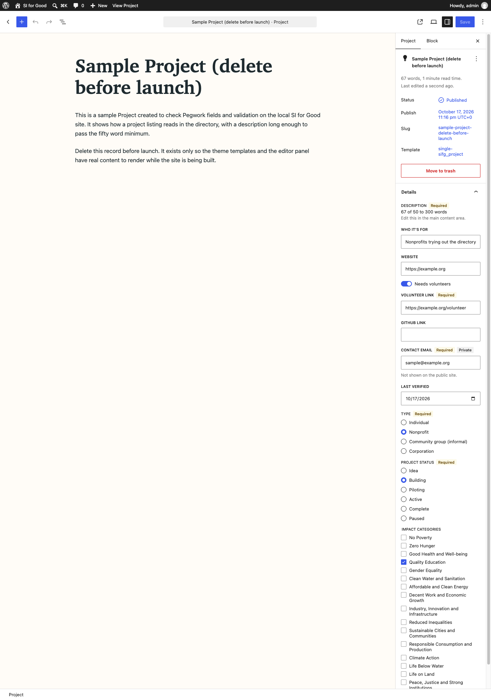
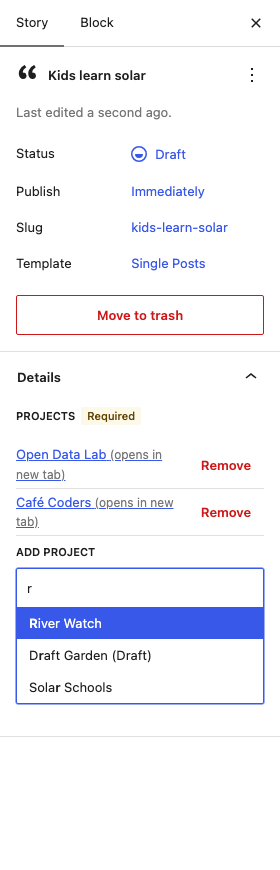

# Editor panel

One `PluginDocumentSettingPanel` ("Details") in the block editor for every post type in the config. It edits meta through core-data (`useEntityProp( 'postType', postType, 'meta' )`), so values save in the same REST request as the post. Server-side validation (PR 4, `RecordValidator`) is authoritative; the panel only gives hints.

Source: `assets/src/editor-panel/`. PHP: `src/Admin/EditorPanel.php`.

## Config contract

PHP localizes `window.pegworkEditor` (inline script before `pegwork-editor-panel`):

```js
window.pegworkEditor = {
	types: {
		<post_type>: {
			fields: [ Field, ... ],               // definition order
			taxonomies: [ Taxonomy, ... ],        // order of the content type's `taxonomies`
			relationships: [ Relationship, ... ], // registry load order; "from" side only
		},
	},
};
```

### Field

| Key | Type | Notes |
|---|---|---|
| `key` | string | Field key. |
| `type` | string | `text`, `textarea`, `rich_text`, `url`, `email`, `number`, `boolean`, `date`, `select`. Unknown types render as text. |
| `label` | string | Defaults to `key`. |
| `required` | bool | Always required (hint only). |
| `visibility` | `public` or `private` | `private` shows a "Private" badge. |
| `meta_key` | string or null | `wp.meta_key`, else `_{post_type}_{key}`. Null unless `storage` is `meta`. |
| `storage` | `meta`, `post_title`, `post_content` | From `wp.storage`; default `meta`. |
| `show_when` | `{field, equals}` or null | Field shows only while the referenced field's value `===` `equals`. |
| `required_when` | `{field, equals}` or null | Required (hint) while the condition holds. |
| `validate` | object | Registry rules (`min_words`, `max_words`, `max_length`, ...). PHP may send `[]` for none; JS reads it as `{}`. |
| `options` | `[{value, label}]` | Select options; `[]` otherwise. |
| `default` | any or null | Shown while the meta value is missing or null. |

### Taxonomy

| Key | Type | Notes |
|---|---|---|
| `key` | string | Taxonomy key. |
| `rest_base` | string | Post attribute holding term IDs. Taxonomy `wp.rest_base`, else `key`. |
| `select` | `single` or `multi` | Default `multi`. |
| `required` | bool | Hint only. |
| `label` | string | Singular label for `single`, plural for `multi`; falls back to `key`. |

### Relationship

Only on the "from" type (`docs/relationships.md`); the "to" type gets no picker.

| Key | Type | Notes |
|---|---|---|
| `key` | string | Relationship key; also the key of its message in `data.fields`. |
| `meta_key` | string | `_rel_{key}`. |
| `to` | string | "To" post type. |
| `label` | string | Section heading: the relationship `label`, else the "to" type's plural label, else `to`. |
| `to_label_singular` | string | "To" type's singular label, else `to`. Combobox label "Add {singular}". |
| `cardinality` | `many_to_many` or `one_to_many` | Default `many_to_many`. Not enforced in the picker; the server rejects a taken `one_to_many` link on save. |
| `required` | bool | Hint only. |

The JS parser (`config.js`) drops malformed entries and fills these defaults, so a bad config never throws. Meta fields without a `meta_key` are dropped, as are relationships without `key`, `meta_key` or `to`.

## Behavior

| Field type | Control |
|---|---|
| text | `TextControl` |
| textarea, rich_text | `TextareaControl` |
| url, email, number, date | `TextControl` with `type` url, email, number, date |
| boolean | `ToggleControl` |
| select | `SelectControl` with a "Choose an option" empty entry |

- `post_title` and `post_content` fields are not rendered; core UI edits them. A `post_content` field with `validate.min_words` or `max_words` gets a live counter ("142 of 50 to 300 words"), counted from `core/editor` content with block comments and tags stripped.
- Empty number inputs store `null`, which deletes the meta value.
- Save errors: when the last save failed with `pegwork_invalid_record` (400), each message in `data.fields` shows in red under its field or taxonomy (read from core-data `getLastEntitySaveError`). Messages for `post_title` fields, and for `post_content` fields without word limits, show as "Label: message" in the panel. Core's "Updating failed" notice still shows too.
- Relationships (`relationship-control.js`, pure logic in `relationship-logic.js`): one section per relationship, after the fields and before the taxonomies. Value is the `_rel_{key}` meta through the same `useEntityProp`, so links save with the post.
  - Heading (`h3`, the `label`, "Required" badge when `required`), then a `<ul>` of linked records labelled by it. Each row: the title linking to its editor in a new tab with visible "(opens in new tab)" text, a status badge when not published (Draft, Pending, Scheduled, Private, Trash), and a "Remove" button named "Remove {title}". Titles resolve in one `getEntityRecords( 'postType', to, { include, status: 'publish,future,draft,pending,private,trash', per_page: 100, context: 'view' } )`; rows show `#ID` plus "Loading linked records" until then. A linked ID the query does not return shows "(missing record #ID)" with Remove.
  - `ComboboxControl` "Add {singular}": typing searches `getEntityRecords( 'postType', to, { search, per_page: 20, status: 'publish,future,draft,pending,private', _fields: 'id,title,status', context: 'view' } )`, debounced 300 ms; an empty input lists the 20 most recent. Linked records are left out; non-published suggestions read "Title (Draft)". `expandOnFocus` is off: typing or ArrowDown opens the list.
  - States: "None linked yet." (plus "Required to publish." when required); spinner plus "Searching" while debouncing or loading; `No matches for "x".`; "Search failed. Try again." and "Could not load linked records." on request errors; the save message from `data.fields[key]` under the section.
  - Focus and announcements: after add, focus stays in the cleared combobox; after remove, focus moves to the next row's Remove button, else the combobox. `speak()` announces "Linked {title}" and "Removed {title}" (assertive); the combobox's own "Item selected." is blanked so it does not announce twice.
  - Known core issue: while the list is open, axe reports `aria-required-attr` (no `aria-controls`) on the combobox input. Core's `TokenInput` sets `aria-owns` instead (WP 6.7 through 7.1); nothing in Pegwork's markup.
- Taxonomies: `single` renders `RadioControl` (plus "None" when not required); `multi` renders checkboxes. Terms come from `getEntityRecords( 'taxonomy', key, { per_page: -1, orderby: 'id' } )`, so seeded order is kept. Core panels are removed with `removeEditorPanel( 'taxonomy-panel-<key>' )`.

## PHP side

- `EditorPanel::register()` (called from `Plugin::boot()`) hooks `enqueue_block_editor_assets` and `allowed_block_types_all`.
- Both read `pegwork_registry()`. `EditorPanel::from_registry( Registry )` builds the config from `content_types()`, `taxonomies()` and `relationships()`.
- The script enqueues only on post editor screens whose post type is in the config, and only when `assets/build/editor-panel.asset.php` exists.
- `EditorPanel::build_config( $content_types, $taxonomies, $relationships )` is pure (registry arrays in, config out).
- Filter `pegwork_editor_panel_config` ( array `$config` ) adjusts the config before it is localized.
- `allowed_block_types_all`: a content type with `wp.allowed_blocks` limits the editor to that list, intersected with any list already set; `false` stays `false`.

Depends on PR 3 (post types get `custom-fields` support so core exposes `meta` in REST; taxonomies have `show_in_rest`) and PR 4 (meta registered with `show_in_rest` and an `auth_callback`, required because `_` keys are protected; `RecordValidator::count_words()` matches `countWords()`).





## Build and test

```sh
npm ci            # npm 11 or later (see architecture.md)
npm run build     # assets/build/ (gitignored; CI builds it)
npm run start     # watch
npm run lint:js
npm run test:unit # Vitest, via wp-scripts test-unit-js
```

`tests/fixtures/editor-panel/config.json` is the expected config for `examples/sifg`, and both sides use it: PHPUnit loads the package through `Loader` and checks `from_registry()` produces it, and the JS tests parse it.
